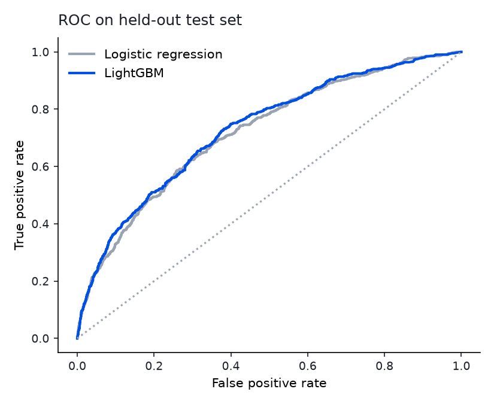
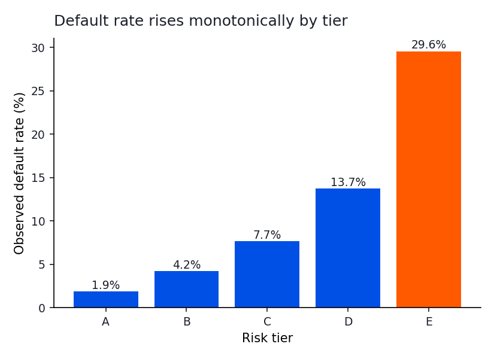
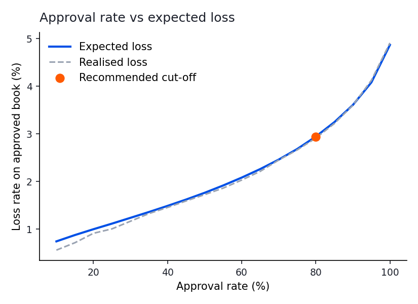
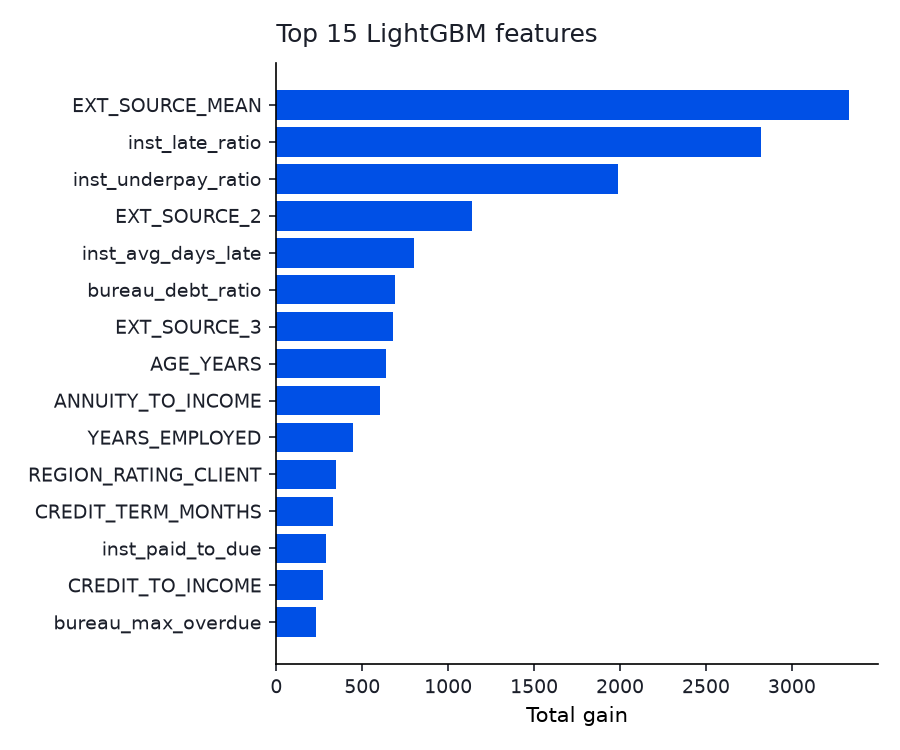

# SME Credit Scoring & Risk Based Pricing Model

A credit scoring and pricing engine for thin-file borrowers, built for **NTU PEAK (Monee Team 1)**.

Our PEAK proposal, TemanUsaha, partners a digital financial platform with Indonesian rural development banks (Bank Perekonomian Rakyat, or BPRs). The BPR underwrites and lends locally, and the platform supplies digital onboarding, bookkeeping data and repayment rails. That only works if the BPR can make a sound credit decision on a merchant with little or no bureau history. This project asks how far behavioural data (how someone has repaid before, how often they pay late, whether they underpay) can carry a credit decision, and how the resulting score turns into limits, tenures and prices a lender could actually offer.

## What it does

1. **Feature engineering in SQL.** Repayment behaviour (late payment ratio, days past due, underpayment ratio, paid to due ratio, last 12 months behaviour) and bureau footprint are aggregated with SQL queries in [`sql/`](sql), run on an in-memory SQLite database. Affordability ratios (annuity to income, credit to income, implied term) are added in pandas.
2. **Model comparison.** A regularised logistic regression baseline against a LightGBM challenger with early stopping, evaluated on a held-out test set with AUC, Gini and KS.
3. **Calibration.** LightGBM scores are Platt calibrated on the validation set so predicted PDs line up with observed default rates, which matters because prices and expected losses are computed from them.
4. **Five risk tiers.** Each tier gets a PD ceiling, a credit limit as a multiple of monthly income and a maximum tenure. Tier E is declined and referred back to bookkeeping and financial coaching, which mirrors the "not yet ready" path in the TemanUsaha app.
5. **Risk based pricing.** A break-even APR per applicant that covers cost of funds, servicing cost, target margin and expected loss, capped at a responsible lending ceiling.
6. **Cut-off simulation.** Approval rate against expected and realised loss across PD cut-offs, then a recommended cut-off at the highest approval rate inside a stated loss appetite.

All business assumptions (LGD, cost of funds, margin, APR cap, tier limits, loss appetite) sit in [`src/credit_risk/config.py`](src/credit_risk/config.py) so they can be challenged in one place. Protected attributes such as gender and family status are excluded from the model by design.

## Results

Trained and evaluated on the full [Home Credit Default Risk](https://www.kaggle.com/competitions/home-credit-default-risk/data) dataset: **307,511 loan applications**, 11.6 million past instalment records and 1.5 million bureau records. The default rate is 8.1%, and 14.3% of applicants have no bureau history at all (thin file). Train, validation and test splits are 60/20/20, stratified on default. Every figure below is from the untouched test set of 61,503 applicants.

| Model | AUC | Gini | KS |
|---|---|---|---|
| Logistic regression (baseline) | 0.751 | 0.502 | 0.379 |
| LightGBM (calibrated) | **0.771** | **0.542** | **0.409** |

| Tier | Share of applicants | Avg predicted PD | Observed default rate | Avg APR | Limit (x monthly income) | Max tenure |
|---|---|---|---|---|---|---|
| A | 30.1% | 1.9% | 1.9% | 14.5% | 3.0 | 24 months |
| B | 25.2% | 4.3% | 4.2% | 16.5% | 2.0 | 18 months |
| C | 20.0% | 7.7% | 7.7% | 19.5% | 1.5 | 12 months |
| D | 15.0% | 13.6% | 13.7% | 25.4% | 1.0 | 6 months |
| E | 9.7% | 28.8% | 29.6% | declined | 0 | n/a |

**What this shows:**

- LightGBM beats the logistic regression baseline by 2 AUC points (Gini 0.542 vs 0.502), picking up non-linear effects in repayment behaviour and affordability.
- After Platt calibration, predicted PDs match observed default rates within 0.8 percentage points in every tier. This matters because prices and expected losses are computed directly from them.
- Default rates rise monotonically from 1.9% in tier A to 29.6% in tier E, a 15x spread.
- At a 3% expected loss appetite, the recommended cut-off approves **80% of applicants** with a bad rate of **4.6%**, against 8.1% if everyone were approved. Realised loss on the approved book (2.91%) lands almost exactly on expected loss (2.94%).

<p>


</p>
<p>


</p>

External credit scores carry the most weight, as expected. Repayment behaviour from the SQL features (late payment ratio over the last 12 months, overall late ratio, number of instalments) and bureau debt ratio still make the top 15. For thin-file merchants with no external score, those behavioural signals are exactly what a platform like TemanUsaha would collect through daily bookkeeping and repayment rails.

## Run it

```bash
git clone https://github.com/<your-username>/sme-credit-risk-model.git
cd sme-credit-risk-model
python -m venv .venv && source .venv/bin/activate   # Windows: .venv\Scripts\activate
pip install -r requirements.txt

python run_pipeline.py --synthetic   # quick check on generated data, no downloads needed
pytest -q                            # unit tests for SQL features, tiers and pricing
```

### On the real Home Credit data

1. Download the [Home Credit Default Risk](https://www.kaggle.com/competitions/home-credit-default-risk/data) dataset from Kaggle (free account, accept the competition rules).
2. Put `application_train.csv`, `installments_payments.csv` and `bureau.csv` in `data/home-credit/`.
3. Run:

```bash
python run_pipeline.py --data-dir data/home-credit
# or a faster first pass:
python run_pipeline.py --data-dir data/home-credit --sample 100000
```

The instalments table is about 720 MB, so it is streamed in chunks into a temporary SQLite database rather than loaded into memory. The full run takes around three minutes and fits in 4 GB of RAM. The `--synthetic` mode generates data with the same schema so the pipeline can be checked without the download; its numbers are not the results above.

## Project structure

```
├── run_pipeline.py              # end to end entry point
├── sql/
│   ├── installments_features.sql
│   └── bureau_features.sql
├── src/credit_risk/
│   ├── config.py                # pricing, tier and risk appetite assumptions
│   ├── data.py                  # streams the Home Credit tables into SQLite
│   ├── features.py              # SQL + pandas feature engineering
│   ├── models.py                # logistic regression, LightGBM, calibration, metrics
│   ├── tiers.py                 # PD to tier, limit and tenure
│   ├── policy.py                # risk based APR and cut-off simulation
│   └── report.py                # charts and summary.md
├── scripts/generate_synthetic_data.py
├── tests/                       # unit tests
└── reports/                     # generated outputs
```

## Limitations

The Home Credit data covers consumer cash and revolving loans, not Indonesian MSME working capital loans, so it is a proxy for the behaviour a BPR would see rather than a like-for-like sample. LGD, funding cost and the APR cap are illustrative assumptions, not figures from any lender. A production model would also need out-of-time validation, reject inference and fairness testing across segments before any lending decision relied on it.

## Context

Built as part of the NTU PEAK Leadership Programme 2026 (Monee Team 1), responding to the problem statement: *How can we better utilise technology to increase access to sustainable financing for SMEs in Southeast Asia, to foster financial inclusion and long-term economic resilience?* The companion app is [TemanUsaha](https://github.com/vaibenz/temanusaha-bookkeeping-app).

## License

MIT
